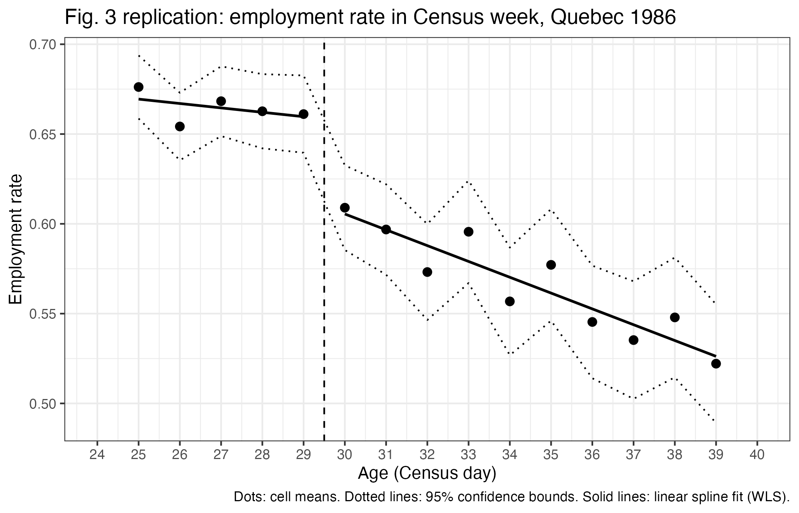
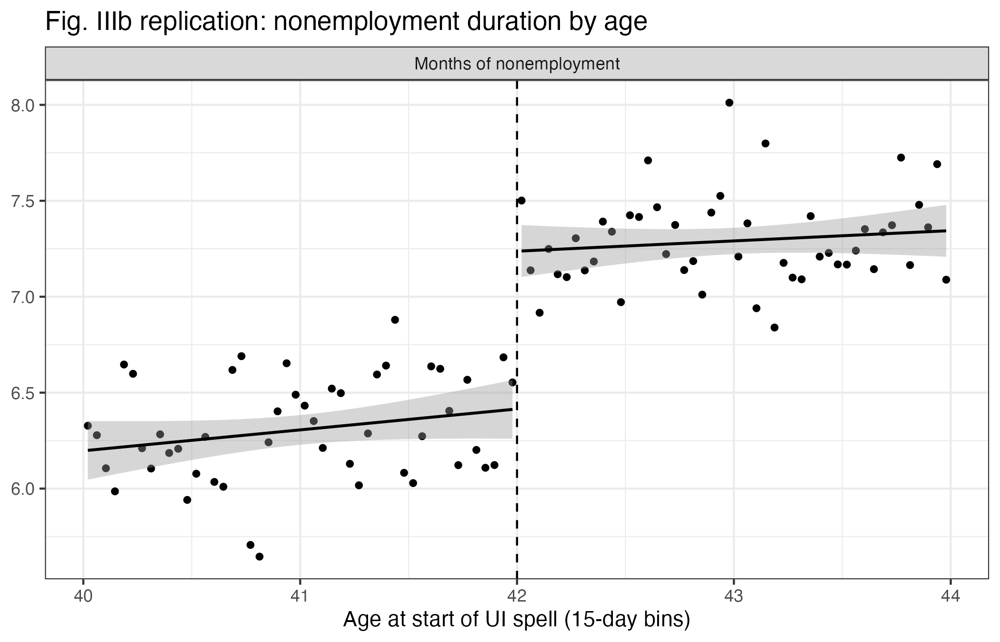

# Regression Discontinuity Replications

Replications of two regression discontinuity (RD) studies in labor economics, written in R:

1. **Lemieux and Milligan (2008)**, "Incentive Effects of Social Assistance: A Regression Discontinuity Approach," *Journal of Econometrics*. Before 1989, childless social assistance recipients in Quebec received $185 per month under age 30 and $507 at 30 and over. The paper uses that jump to estimate how benefit generosity affects employment.
2. **Schmieder, von Wachter, and Bender (2012)**, "The Effects of Extended Unemployment Insurance Over the Business Cycle," *Quarterly Journal of Economics*. In Germany, potential unemployment insurance (UI) duration rises from 12 to 18 months at age 42. The paper uses that threshold to estimate how longer UI eligibility affects time out of work.



*Employment drops at age 30, when Quebec's social assistance benefit nearly tripled. Dots are cell means, lines are the linear spline fit.*

## Results

### Social assistance and employment (Quebec, 1986)

Estimated change in the employment rate at age 30, using the five age specifications in the paper's Table 1. The weighted (WLS) estimates match the published ones to three decimals.

| Specification | OLS | WLS | Published |
|---|---|---|---|
| Linear | -0.038 (0.012) | -0.041 (0.011) | -0.041 |
| Quadratic | -0.051 (0.015) | -0.051 (0.012) | -0.051 |
| Cubic | -0.048 (0.016) | -0.048 (0.014) | -0.048 |
| Linear spline | -0.049 (0.013) | -0.049 (0.011) | -0.049 |
| Quadratic spline | -0.055 (0.022) | -0.056 (0.018) | -0.056 |

Higher benefits lowered employment among 30-year-old childless men by about 5 percentage points, roughly 8 percent of the mean. The drop appears only in Quebec in 1986. It does not appear in Quebec in 1991, after the rule was abolished, or in the rest of Canada, which serve as placebo tests.

### UI duration and nonemployment (Germany, age 42 threshold)

| | UI benefit duration | Nonemployment duration |
|---|---|---|
| Jump at age 42 (reduced form) | 1.093 (0.071) | 0.828 (0.092) |
| Effect of one more month of eligibility (IV) | 0.182 (0.012) | 0.138 (0.015) |
| Published, per month of eligibility | 0.30 | 0.13 |

Standard errors are clustered by 15-day age bin. Each extra month of potential UI adds about four days of nonemployment, close to the published estimate. The UI benefit duration effect (0.182) is below the published 0.30, most likely because of the data: `UI_RD.dta` is a synthetic dataset built to resemble the confidential German records (see Data below), so it reproduces the design and the direction of the effects but not every published magnitude. Predetermined characteristics (education, sex, citizenship, tenure) and the number of claims show no discontinuity at the threshold, which supports the design.



## What the script does

- Plots employment by age for Quebec and the rest of Canada, 1986 and 1991, and replicates the paper's Figure 3
- Estimates the five RD specifications by OLS and by WLS with inverse sampling-variance weights, plus the paper's goodness-of-fit test
- Runs naive OLS of nonemployment on potential UI duration with progressively more controls, for comparison with the RD estimate
- Tests the RD assumptions: density of claims at the cutoff and continuity of predetermined characteristics, as regressions and as binned plots
- Estimates reduced-form RD effects and 2SLS effects, and checks that the IV estimate equals the reduced form divided by the first stage
- Reruns the main estimates without spells that have negative recorded durations

## Data

The data are not included in this repository.

- `lmdata.dta`: age-cell means from the 1986 and 1991 Canadian Censuses, as used by Lemieux and Milligan.
- `UI_RD.dta`: a synthetic dataset built to resemble the German social security records used by Schmieder et al. The original records are confidential.

Both files were provided through a graduate labor economics course. To run the script, place them in a `data/` folder.

## How to run

Requires R 4.x. The script installs `haven`, `fixest`, and `ggplot2` if they are missing.

```r
source("rd_replication.R")
```

Figures (`.png`), LaTeX tables (`.tex`), and a full log are written to `output/`.

## Notes

- Age in the Canadian data is recorded in whole years, so the cutoff is placed at 29.5 on the Census age axis. People coded as 30 are 30.5 years old on average.
- In the German data the first stage is exact: potential duration is 12 months for everyone below 42 and 18 for everyone above. `fixest` will not estimate an IV with a perfect first stage, so 2SLS with clustered standard errors is computed directly.
- The 30 claims at exactly age 44 belong to the next threshold (22 months) and are excluded from the RD sample.
